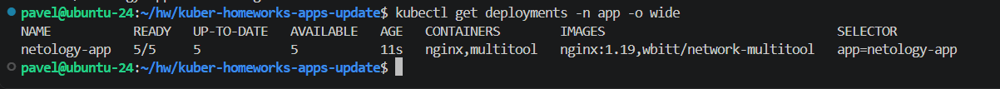
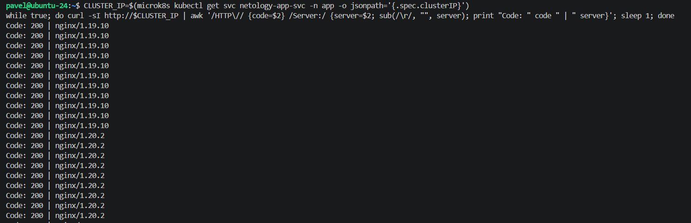
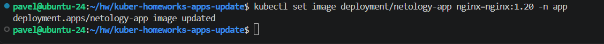
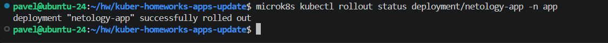
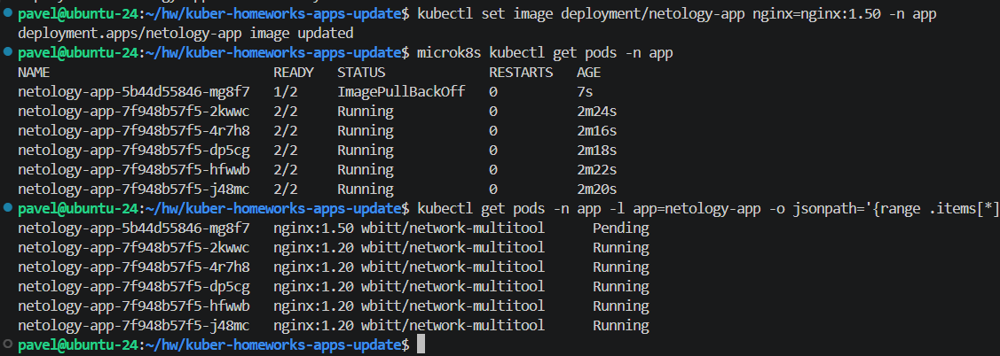

# Домашнее задание к занятию «Обновление приложений» - Рыбянцев Павел

Репозиторий содержит манифесты и описание процесса управления жизненным циклом приложения в Kubernetes: выбор стратегии деплоя, проведение контролируемого обновления (`RollingUpdate`), обработка сбоев при развёртывании некорректных версий и процедура отката (`Rollback`).

---

## Задание 1. Выбор стратегии обновления приложения

### Исходные условия:
* Приложение состоит из нескольких реплик.
* Ресурсы жестко ограничены, увеличить их невозможно.
* Максимальный запас по ресурсам в моменты наименьшей загрузки составляет 20%.
* Обновление мажорное, новая версия **не имеет обратной совместимости** со старой (совместная работа невозможна).

### Выбранная стратегия: Recreate (Пересоздание)

### Обоснование выбора:
1. **Фактор несовместимости версий (главный критерий):** Так как новые и старые версии приложения не умеют работать вместе, стандартные стратегии типа `RollingUpdate` или `Canary` категорически **не подходят**. Если запустить их, в кластере одновременно будут находиться поды обеих версий, что приведёт к нарушению бизнес-логики, ошибкам сессий пользователей или рассинхронизации данных.
2. **Фактор ограничения ресурсов:** Стратегия `Blue-Green` требует единовременного удвоения мощностей (+100% ресурсов), чего у нас нет. Стратегия `RollingUpdate` с параметром `maxSurge` требует как минимум одну или несколько дополнительных инстансов, что впритык укладывается в 20%, но не решает проблему совместимости.
3. **Функционирование Recreate:** При использовании `Recreate` Kubernetes сначала полностью уничтожает все поды старой версии (`1.19`), освобождая 100% занимаемых ими ресурсов. Только после этого начинается планирование и запуск подов новой версии (`1.20`). Таким образом, мы гарантированно укладываемся в жесткие лимиты кластера.
4. **Компромисс:** Единственным минусом данной стратегии является наличие кратковременного простоя (downtime) на время удаления старых и прогрева новых контейнеров. Однако в рамках заданных технических ограничений это единственный безопасный способ провести мажорный апдейт.

---

## Задание 2. Практика: Обновление и откат приложения

Для выполнения практической части используется локальный кластер MicroK8s. Все действия выполняются в изолированном пространстве имён `app`.

### Шаг 2.1. Первоначальный деплой (версия 1.19)
Создаём и применяем манифест `manifests/01-deployment-update.yaml`, содержащий `Deployment` на 5 реплик (в каждом поде по 2 контейнера: `nginx` и `multitool`) и соответствующий `Service`. Чтобы контейнеры не конфликтовали по портам, для `multitool` через переменные окружения заданы порты `8080` и `11443`.

```bash
# Создание пространства имен и деплой приложения
kubectl create namespace app
kubectl apply -f manifests/01-deployment-update.yaml
```

Проверяем статус деплоймента и смотрим текущую запущенную версию образов:
```bash
# Расширенный вывод
kubectl get deployments -n app -o wide
```


### Шаг 2.2. Успешное обновление приложения до версии 1.20 без простоя
Для обеспечения непрерывной доступности в манифесте деплоймента настроена стратегия `RollingUpdate` с параметрами `maxSurge: 20%` (создавать по 1 новому поду за раз) и `maxUnavailable: 0` (не удалять старые поды, пока новые не перейдут в статус Ready).

Перед запуском обновления в отдельном терминале включаем цикл мониторинга доступности:
```bash
# Запуск одноразового тестового пода для непрерывного curl-опроса сервиса
CLUSTER_IP=$(microk8s kubectl get svc netology-app-svc -n app -o jsonpath='{.spec.clusterIP}')
while true; do curl -sI http://$CLUSTER_IP | awk '/HTTP\// {code=$2} /Server:/ {server=$2; sub(/\r/, "", server); print "Code: " code " | " server}'; sleep 1; done
```


В основном терминале обновляем образ `nginx` до версии `1.20`:
```bash
kubectl set image deployment/netology-app nginx=nginx:1.20 -n app
```


Отслеживаем статус развертывания до успешного завершения:
```bash
kubectl rollout status deployment/netology-app -n app
```



### Шаг 2.3. Неудачное обновление до несуществующей версии 1.50
Имитируем ошибку конфигурации/сбой пайплайна, отправив в кластер некорректную версию образа:
```bash
kubectl set image deployment/netology-app nginx=nginx:1.50 -n app
```

Проверяем состояние подов в кластере:
```bash
kubectl get pods -n app
```
Благодаря правильной настройке `maxUnavailable: 0`, старые стабильные поды версии `1.20` продолжают работать и отвечать на запросы пользователей. Новые поды не могут скачаться и зависают в ошибке.

Убеждаемся в этом, проверив статусы образов в реальном времени:
```bash
kubectl get pods -n app -l app=netology-app -o jsonpath='{range .items[*]}{.metadata.name}{"\t"}{.spec.containers[*].image}{"\t"}{.status.phase}{"\n"}{end}'
```


### Шаг 2.4. Откат изменений (Rollback)
Так как обновление заблокировано, возвращаем деплоймент к последней стабильной ревизии:
```bash
kubectl rollout undo deployment/netology-app -n app
```

Убеждаемся, что проблемные поды удалены, а деплоймент вернулся в штатное и полностью рабочее состояние:
```bash
kubectl rollout status deployment/netology-app -n app
kubectl get deployment netology-app -n app -o wide
```


---

## Вывод
В ходе работы были успешно освоены механизмы декларативного обновления приложений в Kubernetes. Правильная конфигурация параметров `maxSurge` и `maxUnavailable` позволила обновить работающее приложение со 100% доступностью (Zero Downtime), а встроенный функционал `rollout undo` гарантировал моментальное восстановление работоспособности системы после деплоя заведомо невалидного образа.
